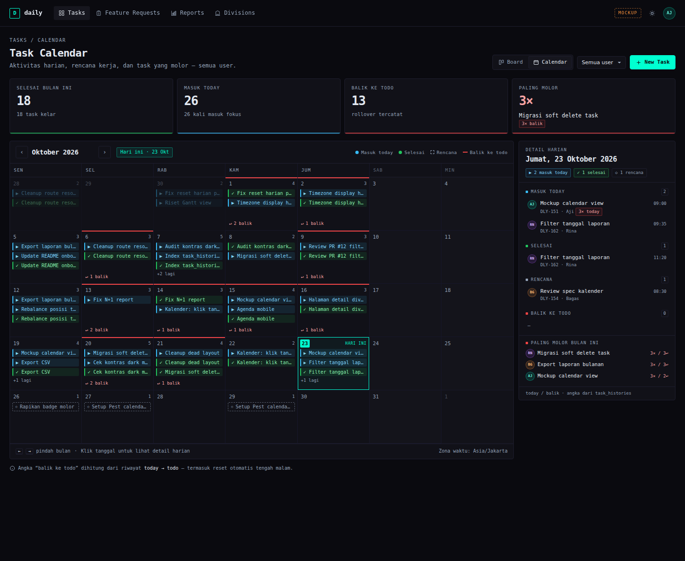
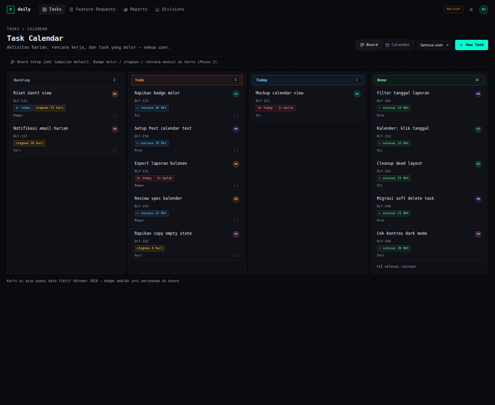
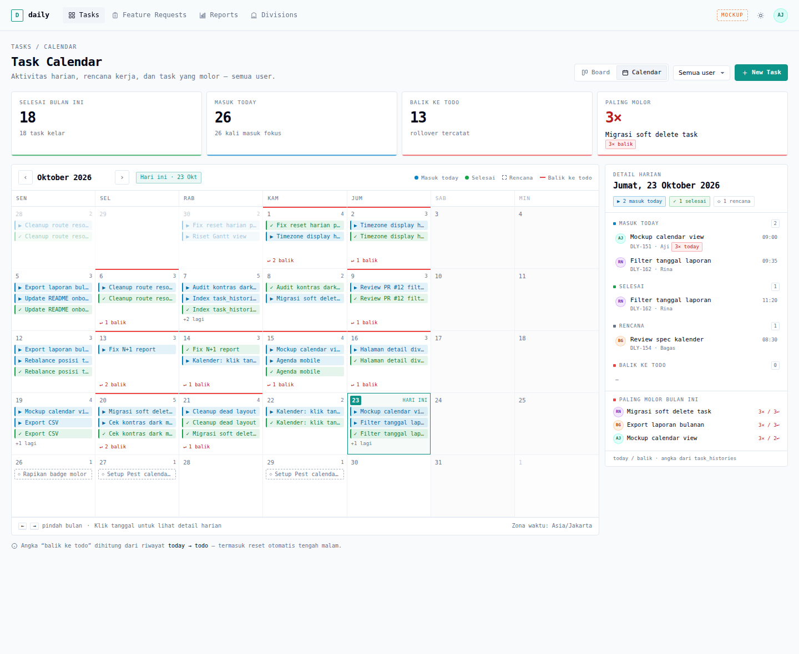
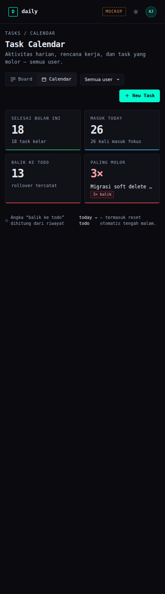

# Task Calendar — Implementation Plan

> **Status:** disetujui 26 Okt 2026. **Phase 0–3 selesai & terverifikasi** (82 passed, 2 skipped).
> **Mockup:** [`docs/mockups/task-calendar.html`](../../mockups/task-calendar.html) · screenshot di [`docs/mockups/screenshots/`](../../mockups/screenshots)

**Goal:** Menambah tampilan kalender di samping board kanban untuk menjawab dua pertanyaan: *"per hari gue ngerjain apa?"* dan *"task mana yang molor?"* — tanpa mengubah default board dan tanpa kolom deadline.

**Architecture:** Satu route baru `GET /tasks/calendar` (`TaskCalendarController`) yang mengembalikan DTO ringkas per tanggal (hasil bucket `task_histories` per zona Asia/Jakarta) + agregat metrik per task. Halaman Svelte baru `tasks/Calendar` menampilkan grid bulanan, panel detail harian, dan agenda untuk mobile. Metrik molor/stagnan dihitung dari `task_histories`, lalu dipakai ulang sebagai badge di kartu kanban. Rencana (`planned_on`) menjadi tanggal kerja lembut di Phase 3 — bukan deadline.

**Tech Stack:** Laravel 12, PHP 8.2+, Inertia v2, Svelte 5 (runes), TypeScript, Tailwind v4, Pest 4, Wayfinder.

---

## 0. Keputusan review (26 Okt 2026)

| # | Pertanyaan | Keputusan |
|---|---|---|
| 1 | Copy UI | **English** — konsisten dengan app; format tanggal `id-ID` |
| 2 | Task terhapus | **Tetap muncul** di riwayat dengan label `(deleted)`; soft delete |
| 3 | Awal minggu | **Senin** |
| 4 | `planned_on` | Dikerjakan 26 Okt 2026 setelah Phase 2 selesai |
| 5 | Urutan agenda mobile | **Naik** (tanggal terlama → terbaru), sesuai mockup |

---

## 1. Keputusan yang sudah dikunci

| # | Keputusan | Alasan |
|---|---|---|
| 1 | **Molor = rollover + aging**, bukan overdue | User tidak memilih deadline. `task_histories` sudah merekam `today → todo`; nol migration untuk metrik ini. |
| 2 | **Kalender bukan pengganti kanban** | Kanban = status, kalender = waktu. Board tetap default. |
| 3 | **Zona waktu tampilan `Asia/Jakarta`**, storage tetap UTC | Menghindari migrasi ulang semua timestamp. Reset harian dijadwalkan 00:00 WIB. |
| 4 | **Soft delete diaktifkan** | Tanpa ini, hapus task = riwayat kerja hilang (FK cascade), kalender retrospektif bolong. |
| 5 | **Tidak ada due date / overdue merah** | Di luar keputusan produk. `planned_on` hanya rencana, bukan deadline. |
| 6 | **Semua user, bisa difilter** | Konsisten dengan board yang sudah menampilkan task semua user. |

### Definisi metrik (final)

```
today_count    = COUNT(histories.to_status = 'today')
rollback_count = COUNT(histories.from_status = 'today' AND histories.to_status = 'todo')
stuck_days     = hari sejak histori terakhir, untuk task berstatus backlog/todo
molor          = rollback_count >= 2 OR today_count >= 3
stagnan        = status IN (backlog, todo) AND stuck_days >= 14
```

> **Catatan jujur:** `rollback_count` juga bertambah saat user sengaja memindahkan task balik ke todo, dan saat reset otomatis tengah malam. Karena itu label UI memakai **"balik ke todo"**, bukan "molor", sampai angkanya dikalibrasi dengan data nyata. Ambang disimpan di config agar mudah di-tuning.

---

## 2. Scope

### In

- Phase 0: fondasi (soft delete, timezone, index, route cleanup, command reset).
- Phase 1: halaman kalender bulanan + panel detail harian + agenda mobile + filter user.
- Phase 2: agregasi metrik + badge di kartu kanban + daftar "paling molor".
- Phase 3: `planned_on` + chip rencana di kalender.

### Out (sengaja tidak dikerjakan)

- Gantt / timeline horizontal (butuh start + end + estimate).
- Deadline & overdue merah, reminder, notifikasi.
- Recurring task, dependency, drag-resize durasi.
- Edit task langsung dari kalender (klik task membuka dialog yang sudah ada — phase lanjutan).
- Export kalender (ICS/PDF), heatmap multi-bulan.
- Perubahan pada MCP tools (kecuali memakai `planned_on` di kemudian hari).

---

## 3. UX Spec

### Desktop (≥1024px)

```
┌──────────────────────────────────────────────────────────────┐
│ header: Tasks · Feature Requests · Reports · Divisions       │
├──────────────────────────────────────────────────────────────┤
│ Tasks / Calendar            [Board | Calendar] [user▾] [+New]│
│ Task Calendar                                                │
│ Aktivitas harian, rencana kerja, dan task yang molor.        │
│                                                              │
│ ┌────────┐ ┌────────┐ ┌────────┐ ┌────────────────┐          │
│ │Selesai │ │Masuk   │ │Balik   │ │Paling molor 3× │          │
│ │  18    │ │today 26│ │todo 13 │ │Export laporan  │          │
│ └────────┘ └────────┘ └────────┘ └────────────────┘          │
│                                                              │
│ ┌───────────────────────────────────┐ ┌───────────────────┐  │
│ │ ‹ Oktober 2026 ›  [Hari ini]      │ │ Detail harian     │  │
│ │ legend                            │ │ Jumat, 23 Okt     │  │
│ │ Sen Sel Rab Kam Jum Sab Min       │ │ ▶ 2 masuk today   │  │
│ │ ┌──┬──┬──┬──┬──┬──┬──┐            │ │ ✓ 1 selesai       │  │
│ │ │  │  │  │  │  │  │  │  grid 5x7  │ │ ◇ 1 rencana       │  │
│ │ │  │  │  │  │  │  │  │            │ │ ── item list ──   │  │
│ │ └──┴──┴──┴──┴──┴──┴──┘            │ │ Paling molor      │  │
│ │ footnote timezone                 │ └───────────────────┘  │
│ └───────────────────────────────────┘                        │
└──────────────────────────────────────────────────────────────┘
```

**Grid cell**
- Nomor tanggal kiri atas; tanggal hari ini diberi blok primary + label `hari ini`.
- Maksimal 3 chip + `+N lagi`.
- Urutan chip: `today` → `done` (bucket `planned` ditunda).
- Strip merah 2px di atas cell jika ada rollback, plus footer `↩ N balik`.
- Weekend sedikit dibedakan; tanggal di luar bulan `opacity .38`.
- Cell adalah `<button>` (bukan div) dengan `aria-label` lengkap: tanggal + jumlah today/selesai/balik.
- Navigasi keyboard: `←/→` pindah hari, `↑/↓` pindah minggu, `Enter/Space` memilih (fokus otomatis pindah).

**Panel detail (desktop)**
- Sticky di kanan, `position: sticky; top: 66px`, lebar 330px.
- Empat seksi: Masuk Today, Selesai, Rencana, Balik ke Todo — masing-masing dengan count.
- Item: avatar inisial user, judul, `DLY-xxx · nama`, jam.
- Badge merah `3× today` untuk task yang kena ambang molor.
- Footer tetap: top-3 "Paling molor bulan ini".

**Mobile (<720px)**
- Grid disembunyikan; diganti **agenda list** per tanggal yang punya aktivitas (tanggal menurun? asc — sesuai mockup ascending).
- Panel detail disembunyikan; semua info ada di agenda.
- Toggle dan filter tetap di atas.

**States**
- Empty month: "Belum ada aktivitas bulan ini." + tombol `Hari ini`.
- Filter user tanpa aktivitas: empty state dengan nama user.
- Day tanpa event: `—` per seksi.
- Loading: Inertia progress bar (sudah ada). Tidak perlu skeleton untuk v1.
- Error validasi `month`: redirect + toast/error (pakai `AlertError` yang sudah ada di halaman lain jika perlu).

**Copy (English, sesuai keputusan review)**

| Konsep | Label UI |
|---|---|
| bucket masuk today | `Today entries` |
| bucket selesai | `Completed` |
| bucket rollback | `Rolled back` |
| bucket rencana (nanti) | `Planned` |
| summary cards | `Completed this month`, `Today entries`, `Rolled back`, `Most delayed` |
| empty state | `No activity this month.` |
| panel kosong | `No activity.` |
| filter | `All users` |

Mockup memakai copy Indonesia hanya supaya konsep kebaca saat review; implementasi memakai label English di atas dengan format tanggal `id-ID`.

---

## 4. Data & API

### Route

```php
// routes/web.php — di dalam group auth+verified, SEBELUM resource
Route::get('tasks/calendar', [TaskCalendarController::class, 'index'])
    ->name('tasks.calendar');

Route::resource('tasks', TaskController::class)->except(['show', 'create', 'edit']);
```

`->except()` wajib: `TaskController` tidak punya `show/create/edit`, jadi route yang terdaftar sekarang akan 500 kalau diakses.

### Query params

| Param | Validasi | Default |
|---|---|---|
| `month` | `nullable`, `date_format:Y-m` | bulan berjalan (WIB) |
| `user_id` | `nullable`, `integer`, `exists:users,id` | semua user |
| `date` | *tidak dipakai server* | dipilih di client |

### DTO props

```jsonc
{
  "month": "2026-10",
  "grid": { "start": "2026-09-28", "end": "2026-11-01" },
  "days": {
    "2026-10-23": {
      "today":    [{ "id": 151, "title": "Mockup calendar view", "reference": "DLY-151",
                     "user": { "id": 1, "name": "Aji" }, "at": "2026-10-23T02:00:00Z", "deleted": false }],
      "done":     [ /* ... */ ],
      "rollback": [ /* ... */ ],
    }
  },
  "summary": {
    "completed": 18,
    "today_entries": 26,
    "rollbacks": 13,
    "top_molor": { "id": 131, "title": "Export laporan bulanan",
                   "today_count": 3, "rollback_count": 3 }
  },
  "users": [{ "id": 1, "name": "Aji" }],
  "filters": { "user_id": null },
  "thresholds": { "today": 3, "rollback": 2, "stale_days": 14 }
}
```

Setiap list di-cap 50 item per hari; tambahkan `"truncated": true` di hari tersebut kalau terpotong.

### Query inti

```php
$tz         = config('tasks.display_timezone');            // Asia/Jakarta
$monthStart = CarbonImmutable::parse($monthParam.'-01', $tz)->startOfMonth();
$monthEnd   = $monthStart->endOfMonth();
$gridStart  = $monthStart->startOfWeek(CarbonImmutable::MONDAY);
$gridEnd    = $monthEnd->endOfWeek(CarbonImmutable::SUNDAY);

$histories = TaskHistory::query()
    ->whereBetween('created_at', [$gridStart->utc(), $gridEnd->endOfDay()->utc()])
    ->when($userId, fn ($q) => $q->whereHas('task', fn ($t) => $t->where('user_id', $userId)))
    ->with([
        'task' => fn ($q) => $q->withTrashed()
            ->select('id', 'user_id', 'title', 'reference', 'status', 'deleted_at'),
        'task.user:id,name',
    ])
    ->orderBy('created_at')
    ->get();

$days = $histories
    ->groupBy(fn (TaskHistory $h) => $h->created_at->setTimezone($tz)->toDateString())
    ->map(function ($items) {
        $out = ['today' => [], 'done' => [], 'rollback' => []];
        foreach ($items as $h) {
            $type = match (true) {
                $h->to_status === 'today' => 'today',
                $h->to_status === 'done' => 'done',
                $h->from_status === 'today' && $h->to_status === 'todo' => 'rollback',
                default => null,
            };
            if ($type) {
                $out[$type][] = [
                    'id' => $h->task_id,
                    'title' => $h->task->title,
                    'reference' => $h->task->reference,
                    'user' => ['id' => $h->task->user->id, 'name' => $h->task->user->name],
                    'at' => $h->created_at->toIso8601String(),
                    'deleted' => $h->task->trashed(),
                ];
            }
        }
        return array_map(fn ($list) => array_slice($list, 0, 50), $out);
    });
```

Metrik (satu query agregat):

```php
$aggregates = TaskHistory::query()
    ->whereIn('task_id', $taskIds)
    ->selectRaw("task_id,
        SUM(CASE WHEN to_status = 'today' THEN 1 ELSE 0 END) AS today_count,
        SUM(CASE WHEN from_status = 'today' AND to_status = 'todo' THEN 1 ELSE 0 END) AS rollback_count,
        MAX(created_at) AS last_moved_at")
    ->groupBy('task_id')
    ->get()
    ->keyBy('task_id');
```

`stuck_days` dihitung di PHP dari `last_moved_at` (WIB), hanya untuk status `backlog`/`todo`. `molor` dan `top_molor` memakai ambang dari `config/tasks.php`.

### Config baru

```php
// config/tasks.php
return [
    'display_timezone' => env('TASKS_DISPLAY_TIMEZONE', 'Asia/Jakarta'),
    'molor' => [
        'today_threshold' => 3,
        'rollback_threshold' => 2,
    ],
    'stale_after_days' => 14,
];
```

---

## 5. File Map

| File | Perubahan |
|---|---|
| `database/migrations/2026_10_24_000000_add_task_calendar_indexes.php` | Create — index `task_histories(created_at)`, `(task_id, created_at)`, `tasks(user_id, status)` |
| `database/migrations/2026_10_26_000001_add_planned_on_to_tasks_table.php` | Create — `planned_on` date nullable + index `(user_id, planned_on)` |
| `app/Models/Task.php` | Modify — `SoftDeletes`, `planned_on` fillable + cast |
| `app/Models/TaskHistory.php` | Tidak berubah |
| `app/Http/Controllers/TaskCalendarController.php` | Create |
| `app/Http/Controllers/TaskController.php` | Modify — props `metrics`, validasi `planned_on` |
| `app/Actions/Tasks/ComputeTaskMetrics.php` | Create — agregasi today/rollback/stuck |
| `app/Console/Commands/ResetTodayTasks.php` | Create — extract dari closure `console.php`, sekaligus set `position` |
| `routes/web.php` | Modify — route calendar + resource `except` |
| `routes/console.php` | Modify — schedule command 00:00 WIB |
| `config/tasks.php` | Create |
| `resources/js/pages/tasks/Calendar.svelte` | Create |
| `resources/js/pages/tasks/Index.svelte` | Modify — pakai `TaskCard`, tambah toggle |
| `resources/js/components/tasks/TaskViewToggle.svelte` | Create |
| `resources/js/components/tasks/CalendarMonth.svelte` | Create |
| `resources/js/components/tasks/CalendarDay.svelte` | Create |
| `resources/js/components/tasks/CalendarStats.svelte` | Create — 4 summary cards |
| `resources/js/components/tasks/CalendarAgenda.svelte` | Create — agenda mobile |
| `resources/js/components/tasks/DayDetail.svelte` | Create |
| `resources/js/components/tasks/TaskCard.svelte` | Create — ekstrak dari Index (menghapus duplikasi markup done vs non-done) |
| `resources/js/components/tasks/TaskBadges.svelte` | Create — badge molor/stale/focus/done |
| `resources/js/lib/users.ts` | Create — `getUserColor` bersama |
| `resources/js/lib/date.ts` | Create — helper bulan/grid/format id-ID |
| `resources/js/types/tasks.ts` | Create — `TaskMetric`, `CalendarDay`, `CalendarProps` |
| `resources/js/layouts/app/AppHeaderKanbanLayout.svelte` | Modify — link `Tasks` tetap; toggle ada di halaman, bukan di nav |
| `tests/Feature/TaskCalendarTest.php` | Create |
| `tests/Feature/TaskMetricsTest.php` | Create |
| `tests/Feature/TaskSoftDeleteTest.php` | Create |
| `tests/Feature/ResetTodayTasksTest.php` | Create |
| `tests/Feature/TaskTest.php` | Modify — perbaiki nama komponen `tasks/Index` |
| `tests/Feature/DashboardTest.php` | Modify — dashboard sekarang redirect, bukan 200 |

---

## 6. Phase 0 — Fondasi (½–1 hari) — ✅ SELESAI

### Task 0.0 — Portabilitas migration (SQLite)

**File:** `database/migrations/2026_07_01_041059_change_status_to_string_on_feature_requests_table.php`

- [x] `MODIFY COLUMN` hanya dijalankan untuk driver MySQL/MariaDB; SQLite/PostgreSQL no-op.
- [x] Alasan: test & instalasi lokal memakai SQLite (`phpunit.xml` → `:memory:`), dan migration ini sebelumnya membuat `migrate` gagal total.

### Task 0.1 — Aktifkan SoftDeletes

**File:** `app/Models/Task.php`

- [x] Tambah `use Illuminate\Database\Eloquent\SoftDeletes;` dan `use SoftDeletes;`.
- [x] Pastikan tidak ada query yang harus tetap melihat task terhapus (board, report, MCP) — default scope otomatis menyembunyikan, itu yang diinginkan.
- [x] Tulis `TaskSoftDeleteTest`: `delete()` → `assertSoftDeleted('tasks')`, baris `task_histories` **masih ada**, `Task::withTrashed()` menemukan task.
- [x] Cek `task_histories.task_id` FK tetap `cascadeOnDelete` — aman karena soft delete tidak menghapus baris.

### Task 0.2 — Reset harian: command + timezone + position

**File:** `app/Console/Commands/ResetTodayTasks.php`, `routes/console.php`

- [x] Extract closure jadi command `tasks:reset-today`.
- [x] Saat reset, isi `position = max(todo user) + 1` supaya task tidak melompat ke atas kolom todo (bug lama).
- [x] Schedule:

```php
Schedule::command('tasks:reset-today')
    ->dailyAt('00:00')
    ->timezone(config('tasks.display_timezone'));
```

- [x] Command menulis `TaskHistory` (`today → todo`) untuk setiap task, dalam satu `DB::transaction`.
- [x] Test: `$this->artisan('tasks:reset-today')`, assert status + position + history; plus assert event terjadwal `0 0 * * *` dengan timezone `Asia/Jakarta`.
- [x] Hapus test lama yang menyalin logika closure secara manual.

### Task 0.3 — Index

**File:** migration baru

- [x] `Schema::table('task_histories', ...)` index `created_at` dan `['task_id', 'created_at']`.
- [x] `Schema::table('tasks', ...)` index `['user_id', 'status']`.
- [x] Down: drop index dengan nama eksplisit agar rollback aman.

### Task 0.4 — Route cleanup

**File:** `routes/web.php`

- [x] `Route::resource('tasks', ...)->except(['show', 'create', 'edit'])`.
- [x] Test: `GET /tasks/create` dan `GET /tasks/1` mengembalikan **405** (bukan 500) karena method-nya tidak terdaftar.
- [x] Route calendar akan diletakkan sebelum resource di Phase 1.

### Task 0.5 — Config

- [x] Buat `config/tasks.php` (lihat §4).
- [x] Tambah `TASKS_DISPLAY_TIMEZONE` ke `.env.example` (opsional, ada default).

### Task 0.6 — Rapikan test stale

- [x] `DashboardTest`: authenticated dashboard → `assertRedirect(route('tasks.index'))`.
- [x] `TaskTest`: komponen `Tasks/Index` → `tasks/Index`.
- [x] `RegistrationTest`: registrasi dimatikan di `config/fortify.php`; ditandai skipped dengan alasan.
- [x] `vendor/bin/pint --test` + `php artisan test` hijau sebelum masuk Phase 1.
- [x] `tests/TestCase.php`: `withoutVite()` supaya test tidak butuh `public/build/manifest.json`.

**Verifikasi Phase 0 (26 Okt 2026, PHP 8.4 + SQLite):**

```
php artisan test .......... 55 passed, 2 skipped (183 assertions)
vendor/bin/pint --test .... 85 files PASS
php artisan migrate ....... 13 migrations DONE (SQLite fresh)
php artisan schedule:list . 0 0 * * *  php artisan tasks:reset-today
php artisan route:list .... tasks.index/store/update/destroy/reorder only
```

**Acceptance Phase 0**
- [x] `php artisan test` hijau.
- [x] Hapus task tidak menghilangkan history.
- [x] Reset harian jalan 00:00 WIB dan tidak merusak urutan todo.
- [x] Migrasi bisa dijalankan di SQLite (lokal/test) tanpa error.

---

## 7. Phase 1 — Halaman Kalender (2–2.5 hari) — ✅ SELESAI

### Task 1.1 — Controller + DTO

**File:** `app/Http/Controllers/TaskCalendarController.php`

- [x] Validasi `month` (`date_format:Y-m`) dan `user_id`.
- [x] Bangun grid range Senin–Minggu.
- [x] Query history + grouping per tanggal WIB (lihat §4).
- [x] Hitung summary bulan berjalan (completed, today_entries, rollbacks) dan `top_molor` dari action metrik.
- [x] Ambil `users` untuk filter.
- [x] Props: `month`, `grid`, `days`, `summary`, `molorTasks`, `users`, `filters`, `thresholds`.
- [x] `Inertia::render('tasks/Calendar', ...)`.

### Task 1.2 — Action metrik, helper tanggal, types

**File:** `app/Actions/Tasks/ComputeTaskMetrics.php`

- [x] `__invoke(Collection $tasks): array` → `[taskId => ['today_count','rollback_count','stuck_days','is_molor']]` (menambahkan `last_moved_at` internal untuk `stuck_days`).
- [x] Satu query agregat (`SUM(CASE WHEN ...)`), tanpa N+1.
- [x] Threshold dari `config('tasks.molor')`.
- [x] `stuck_days` dihitung di WIB dengan `diffInDays`.
- [x] `top_molor`: urutkan `today_count * 2 + rollback_count` desc, ambil 3 dengan skor > 0.

**File:** `resources/js/lib/date.ts` (nama final)

```ts
export const DISPLAY_TIMEZONE = 'Asia/Jakarta';

export function todayInAppTimezone(): string;            // 'YYYY-MM-DD' di WIB
export function formatMonth(month: string): string;      // 'Oktober 2026'
export function formatDay(date: string): string;         // 'Jumat, 23 Oktober 2026'
export function formatDateShort(date: string): string;   // '23 Okt'
export function formatWeekday(date: string): string;     // 'Jumat'
export function formatTime(isoDate: string): string;     // '09:05'
export function addDays(date: string, days: number): string;
export function addMonths(month: string, delta: number): string;
export function isWeekend(date: string): boolean;
export function dayNumber(date: string): number;
```

- [x] Semua formatting pakai `Intl.DateTimeFormat` dengan `timeZone` eksplisit (`Asia/Jakarta` untuk waktu, `UTC` untuk tanggal kalender).
- [x] Aritmetika grid pakai UTC (`Date.UTC` / `getUTCDate`) supaya bebas DST.

**File:** `resources/js/types/tasks.ts` — `CalendarUser`, `CalendarEvent`, `CalendarDay`, `MolorTask`, `CalendarSummary`, `CalendarThresholds`, `CalendarProps`.

### Task 1.3 — Halaman + komponen

- [x] `TaskViewToggle.svelte`: segmented `Board | Calendar` memakai Inertia `Link` + `aria-current`.
- [x] `CalendarMonth.svelte`: header bulan, tombol prev/next/hari ini, legend, grid 7 kolom, navigasi keyboard (dipindah ke tiap tombol tanggal agar a11y bersih).
- [x] `CalendarDay.svelte`: satu cell; chip max 3; `+N lagi`; strip + footer rollback; `aria-label` lengkap.
- [x] `DayDetail.svelte`: panel kanan; 3 seksi (Today entries / Completed / Rolled back); top-3 molor; state kosong.
- [x] `Calendar.svelte`: state `selectedDate`, `month`, `userId`; `router.get` saat bulan/filter berubah dengan `preserveState`, `preserveScroll`, dan partial reload.
- [x] Mobile: agenda list dari `days` (urut tanggal naik), item per event, bukan grid yang di-crop.
- [x] `CalendarStats.svelte` + `CalendarAgenda.svelte` dipisah supaya `Calendar.svelte` tetap di bawah ~200 baris.

**State di URL:** `?month=2026-10&user_id=2`. Tanggal terpilih **tidak** dikirim ke server (client-only) supaya klik hari tidak memicu request.

### Task 1.4 — Navigasi dari board

- [x] Tambah `TaskViewToggle` di header `tasks/Index.svelte` dan `tasks/Calendar.svelte`.
- [x] Simpan pilihan terakhir? Tidak — URL adalah source of truth. Board tetap default saat buka `/tasks`.

### Task 1.5 — Test

`tests/Feature/TaskCalendarTest.php`:

- [x] Component `tasks/Calendar`, props `days/summary/users/filters`.
- [x] `month=2026-10` hanya memuat event Oktober (plus sisa grid September/November).
- [x] Bucket per tanggal WIB: history `2026-10-22 17:30:00` UTC → muncul di `2026-10-23`.
- [x] Rollback terdeteksi dari `today → todo`, bukan dari `todo → today`.
- [x] Filter `user_id` hanya mengembalikan event user tersebut.
- [x] Task yang di-soft-delete tetap muncul di `days` dengan `deleted: true` (termasuk saat filter user aktif).
- [x] `month=2026-13` → validation error / redirect dengan error.

**Acceptance Phase 1**
- [x] `/tasks/calendar` bisa dibuka, bulan bisa digeser, filter user bekerja.
- [x] Hari dengan rollback punya penanda visual dan jumlah yang benar.
- [x] Mobile menampilkan agenda, bukan grid yang di-crop.
- [x] Query history dibatasi rentang grid (satu query) + agregat metrik satu query.

**Verifikasi Phase 1 (26 Okt 2026, container `daily-app`, MySQL `daily_test`):**

```
php artisan test ................. 68 passed, 2 skipped (322 assertions)
  TaskCalendarTest ............... 13 passed (139 assertions)
docker compose run --rm vite ..... exit 0 (wayfinder + vite build)
browser /tasks/calendar .......... 200, 35 day cells, 0 console error, no overflow
browser toggle Board → Calendar .. works, 35 day cells
browser mobile 390px ............. grid hidden, agenda visible, no overflow
svelte-check ..................... file baru bersih
```

---

## 8. Phase 2 — Metrik & Badge Kanban (1–1.5 hari) — ✅ SELESAI

### Task 2.1 — Props board

**File:** `app/Http/Controllers/TaskController.php`

- [x] Setelah `Task::with(...)->get()`, panggil `ComputeTaskMetrics` untuk semua task, lalu kirim prop `metrics` (map id → metric).
- [x] Perluas action dengan `is_stale` memakai `config('tasks.stale_after_days')`.
- [x] Jangan ubah sorting/position logic.
- [x] Threshold tetap dipakai server-side (`is_molor`/`is_stale`), jadi board tidak perlu prop tambahan.

### Task 2.2 — Ekstrak `TaskCard` + badges

- [x] Pindahkan markup kartu dari `tasks/Index.svelte` (dua blok duplikat: done dan non-done) ke `TaskCard.svelte` (599 baris, turun dari 728).
- [x] Props: `task`, `mine`, `metric`, `showReorder`, `canMoveUp`, `canMoveDown`, `onOpen`, `onDragStart`, `onMoveUp`, `onMoveDown`.
- [x] `TaskBadges.svelte` aturan tampilan (maks 2 badge, English):
  - done → `✓ Done 23 Oct` (hijau)
  - `is_molor` → `3× today · 2↩` (merah) + tooltip penjelasan
  - `is_stale` → `Stale 20d` (amber)
  - today (jika bukan molor) → `▶ Focus today` (cyan)
  - `planned_on` → `◇ Plan 26 Oct` (dashed)
- [x] `lib/users.ts` menyatukan `getUserColor`; `getInitials` dari `lib/initials`.
- [x] Tombol ↑/↓ reorder tetap berfungsi (`stopPropagation` dipertahankan).
- [x] Drag & drop tidak berubah.

### Task 2.3 — Test

`tests/Feature/TaskMetricsTest.php`:

- [x] Dua `today → todo` + tiga `to today` → `is_molor = true`.
- [x] Task `todo` dengan history terakhir 15 hari → `is_stale = true` (`stuck_days = 15`).
- [x] Task `done` tidak pernah `is_stale`.
- [x] `metrics` terkirim di props `tasks.index` dan key-nya sesuai id task.
- [x] Task tanpa history → `stuck_days = null`, tidak error.

**Acceptance Phase 2**
- [x] Badge muncul di kartu backlog/todo/today tanpa menggeser judul.
- [x] Board tidak menambah query per kartu (satu query agregat).
- [x] Klik kartu tetap membuka dialog yang sama; drag & drop dan reorder tetap jalan.

**Verifikasi Phase 2 (26 Okt 2026, container `daily-app`, MySQL `daily_test`):**

```
php artisan test ................. 73 passed, 2 skipped (400 assertions)
  TaskMetricsTest ................ 5 passed (72 assertions)
docker compose run --rm vite ..... exit 0
browser /tasks ................... metrics 3× today/2 rollback → badge merah tampil
                                   stuck_days 20 → badge amber tampil
                                   0 console error, tidak overflow
```

Screenshot board dengan badge: `docs/mockups/screenshots/implemented-board-badges.png`.
Data demo untuk screenshot sudah dihapus kembali setelah verifikasi.

### Follow-up fix (26 Okt 2026) — invariant satu `today`

- [x] `store` dengan `status=today` sekarang menurunkan semua task `today` lain ke `todo` (posisi append), sama seperti `update`.
- [x] Logika duplikat diekstrak ke `TaskController::demoteTodayTasks()`, dipakai `store` dan `update`.
- [x] `lockForUpdate()` pada row user + row task `today` untuk menserialkan request bersamaan per user.
- [x] Legacy data dengan beberapa task `today` ikut dibereskan: semuanya diturunkan, bukan hanya yang pertama.
- [x] Test: existing today, multiple legacy today, dan tanpa existing today.
- [x] Verifikasi final: **76 passed, 2 skipped (413 assertions)**.

### Follow-up fix (26 Okt 2026) — error type frontend

- [x] Alias ikon `User` → `UserIcon` di `feature-requests/Index.svelte` dan `Show.svelte` (bentrok dengan interface `User`).
- [x] `onclickoutside` (bukan event Svelte) diganti action `use:clickOutside` di `tasks/Index.svelte`.
- [x] Action punya `ignore` selector supaya tombol trigger tetap bisa menutup menu; listener `pointerdown` capture + cleanup.
- [x] Escape menutup dropdown; `aria-haspopup="menu"` + `aria-expanded` ditambahkan.
- [x] Verifikasi: `npm run check` → **0 errors**, 13 warning lama (`state_referenced_locally` di form feature-requests, sengaja belum disentuh).
- [x] Browser: buka filter → klik luar → tertutup; buka lagi → Escape → tertutup; halaman feature-requests render tanpa console error.

---

## 9. Phase 3 — Rencana / `planned_on` — ✅ SELESAI

> Rencana adalah tanggal kerja yang lembut, bukan deadline. Tidak ada status merah/overdue dari `planned_on`.

### Task 3.1 — Migration & model

- [x] `planned_on` date nullable, index `['user_id', 'planned_on']`.
- [x] `Task::$fillable` + cast `'planned_on' => 'date:Y-m-d'` (serialisasi tanggal polos ke frontend).

### Task 3.2 — Validasi & form

- [x] `TaskController@store/update`: `'planned_on' => ['nullable', 'date']`.
- [x] Dialog task: input `type="date"`, `min` = hari ini, ikut `useForm`; update mengosongkan lewat input kosong.
- [x] Tidak mengubah history (rencana bukan perubahan status).

### Task 3.3 — Kalender

- [x] Query task dengan `planned_on` di rentang grid + filter user; task terhapus tidak muncul.
- [x] Bucket `planned` per tanggal, cap 50/hari seperti bucket lain.
- [x] Chip dashed + ikon `◇`, section **Planned** di panel detail, baris planned di agenda mobile.
- [x] Badge `◇ Plan 26 Oct` di kartu board.
- [ ] Drag chip ke tanggal lain — **tidak** dikerjakan (belum dibutuhkan).

### Task 3.4 — Test

- [x] Task dengan `planned_on` muncul di tanggal yang benar (`2026-10-23` → 23).
- [x] `planned_on = null` tidak error dan tidak muncul.
- [x] Filter user berlaku untuk planned.
- [x] Create/update/clear `planned_on` lewat `tasks.store` & `tasks.update` tanpa mengubah field lain.
- [x] Board mengirim `planned_on` untuk badge.

**Acceptance Phase 3**
- [x] Bisa melihat rencana ke depan tanpa mengubah arti "molor".
- [x] Tidak ada overdue/merah dari `planned_on`.

**Verifikasi Phase 3 (26 Okt 2026, container `daily-app`):**

```
php artisan test ............... 82 passed, 2 skipped (466 assertions)
docker compose run --rm vite ... exit 0
npm run check .................. 0 errors, 13 warning lama

browser /tasks/calendar ........ chip ◇ pada 28 Okt, section Planned terisi
browser /tasks ................. 2 badge "◇ Plan 26/28", dialog punya input date (min hari ini)
0 console error, tidak overflow
```

Screenshot: `docs/mockups/screenshots/implemented-calendar-planned.png`, `implemented-board-planned.png`.
Data demo untuk screenshot sudah dihapus setelah verifikasi.

---

## 10. Testing Strategy

| Level | Apa | Alat |
|---|---|---|
| Feature | Route, props, filter, timezone bucket, soft delete, reset command | Pest 4 |
| Unit | `ComputeTaskMetrics` (threshold, stuck days) | Pest |
| Manual | Keyboard nav, dark/light, 320/768/1024/1440, empty states | Checklist |

Manual QA checklist:

- [ ] Tab melalui grid: fokus terlihat, `Enter` memilih tanggal.
- [ ] `←/→/↑/↓` memindahkan fokus antar tanggal.
- [ ] Semua chip punya teks, bukan warna saja.
- [ ] Kontras teks chip ≥ 4.5:1 (dark & light).
- [ ] Tidak ada horizontal scroll di 1440, 1024, 768, 390.
- [ ] Filter user + ganti bulan tidak kehilangan state filter.
- [ ] Task yang dihapus tampil `(dihapus)` di panel, tidak bisa diklik.
- [ ] Board tetap berfungsi: drag, reorder, dialog, delete.

---

## 11. Rollout

1. `php artisan migrate` (index + `planned_on`).
2. `php artisan wayfinder:generate && npm run build` (route baru butuh Wayfinder).
3. Deploy.
4. Smoke test: `/tasks` (board), `/tasks/calendar`, filter, reset command manual (`php artisan tasks:reset-today` di staging).
5. Monitor: waktu query kalender + jumlah query (Telescope/Pail). Target < 150ms untuk data < 5k history.

**Rollback:** route + halaman bersifat aditif. Revert kode cukup menghilangkan akses; migration index aman dibiarkan. Soft delete tidak menghapus data.

---

## 12. Risks & Open Questions

| Risiko | Dampak | Mitigasi |
|---|---|---|
| Rollback ≠ molor (niat vs reset) | Angka menyesatkan | Label "balik ke todo", tooltip, tuning threshold setelah data nyata |
| Timezone salah bucket | Event masuk tanggal yang salah | Test batas 17:00 UTC = 00:00 WIB; semua grouping eksplisit WIB |
| Volume `task_histories` | Query lambat | Index, filter rentang, cap 50/hari, agregasi satu query |
| Soft delete mengubah report/MCP | Task terhapus hilang dari laporan | Diharapkan; dokumentasikan di PR |
| Mobile agenda beda dari desktop | Fitur tidak konsisten | Agenda pakai data yang sama; test 390px |
| Test lama stale | CI merah | Phase 0.6 |

**Resolved (26 Okt 2026):** English copy · task terhapus tetap tampil (`(deleted)`) · minggu mulai Senin · `planned_on` ditunda · agenda mobile urut naik.

**Open questions yang masih tersisa:**

1. **Kalibrasi ambang molor:** setelah ada data nyata, apakah `rollback >= 2` / `today >= 3` terlalu sensitif?
2. **Retensi history:** perlu prune `task_histories` setelah sekian lama, atau simpan selamanya untuk kalender?

---

## 13. Estimasi

| Phase | Estimasi | Deliverable |
|---|---|---|
| 0 | 0.5–1 hari | ✅ selesai — fondasi + test hijau |
| 1 | 2–2.5 hari | ✅ selesai — kalender + panel + mobile |
| 2 | 1–1.5 hari | ✅ selesai — metrik + badge board |
| 3 | 1–1.5 hari | ✅ selesai — `planned_on` + chip rencana |
| QA/polish | 1 hari | a11y, responsive, screenshot review |
| **Total** | **5.5–7.5 hari** | Phase 0–3 selesai |

---

## 14. Referensi Mockup

- Interaktif: [`task-calendar.html`](../../mockups/task-calendar.html) — bisa ganti bulan, klik tanggal, filter user, toggle tema, toggle Board/Calendar.
- Screenshot:
  - 
  - 
  - 
  - 

Mockup memakai token dari `resources/css/app.css` (background `#0a0a0f`, card `#111118`, primary `#00FFD1`, radius 4px, font monospace) dan data fiktif Oktober 2026 — bukan kode produksi.
